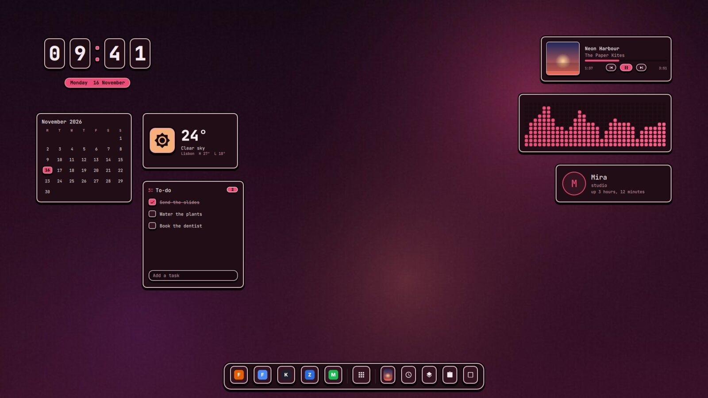
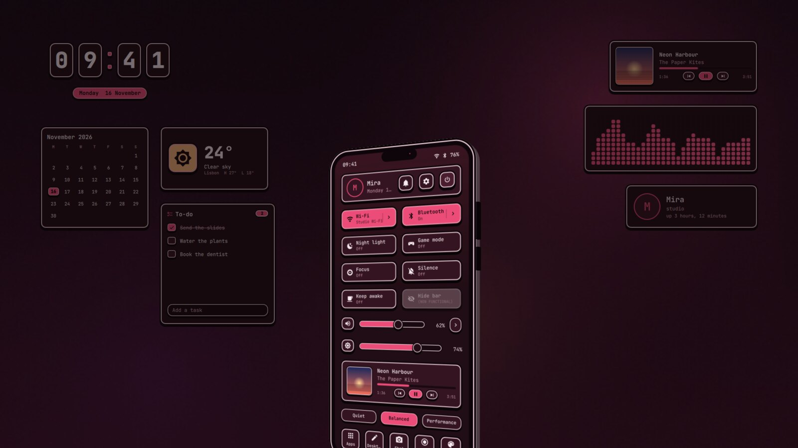
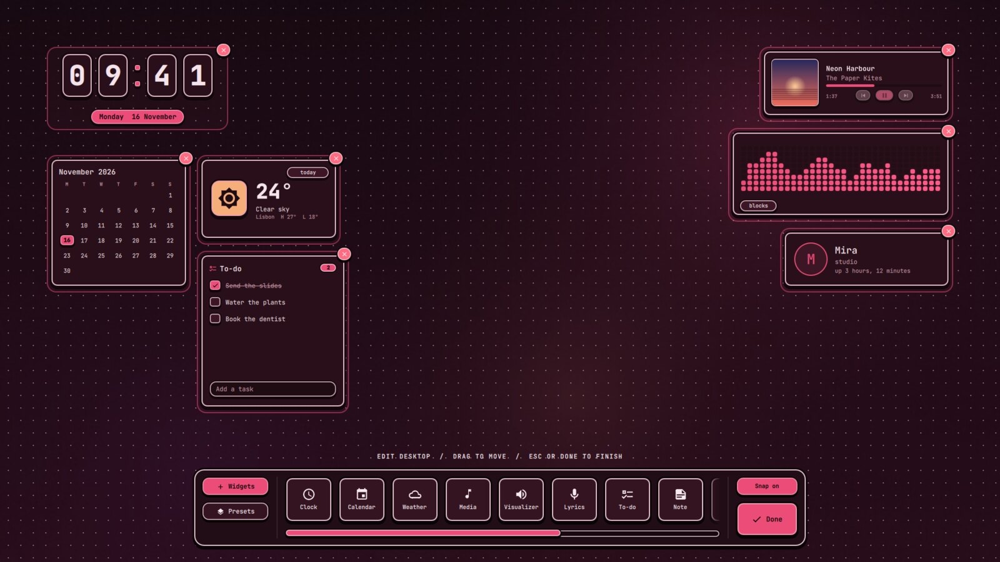
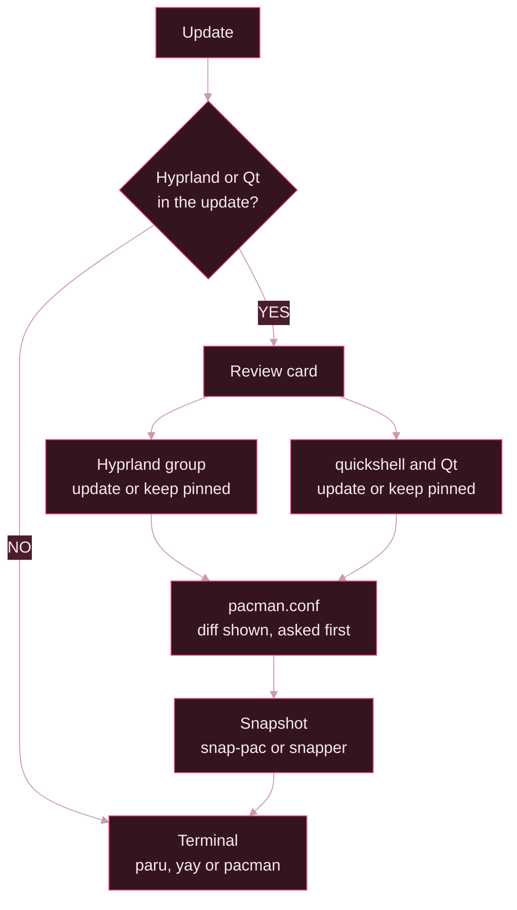
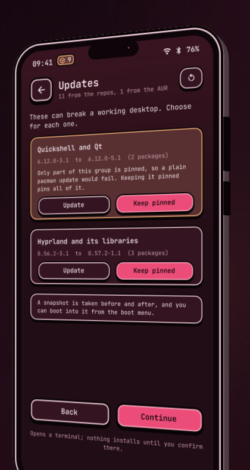
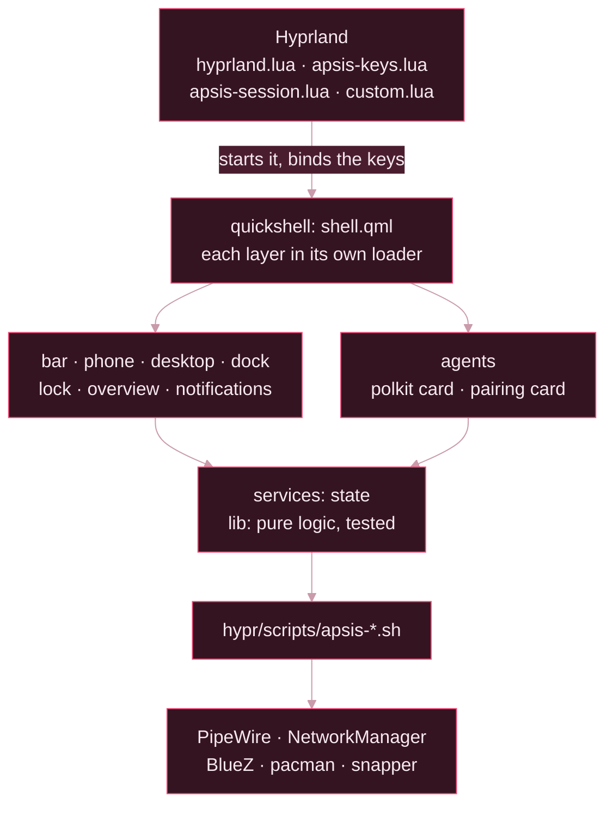

# Apsis

<p align="center">
  
</p>

<p align="center">
  <b>1.0.0</b> &nbsp;·&nbsp; Hyprland 0.55+ (Lua config) &nbsp;·&nbsp; quickshell (Qt6) &nbsp;·&nbsp; uwsm &nbsp;·&nbsp; SDDM
  <br>
  <a href="#install">Install</a> &nbsp;·&nbsp;
  <a href="#keys">Keys</a> &nbsp;·&nbsp;
  <a href="#updates-pins-and-snapshots">Updates</a> &nbsp;·&nbsp;
  <a href="#how-it-fits-together">How it fits together</a> &nbsp;·&nbsp;
  <a href="#reference">Reference</a>
</p>

Apsis is a Hyprland desktop whose whole interface is drawn in quickshell from a
single building block. A phone rises from the bottom edge for the quick panel,
apps, sound, Wi-Fi, Bluetooth, updates and settings. Around it sit draggable
desktop widgets with presets, a dock with pop-up cards, a workspace overview, a
wallpaper wheel with palette-coloured transitions, a keycap lockscreen and a
login screen that follows the live colours. Every layer loads on its own, so one
failing never takes the rest down.

<table>
  <tr>
    <td width="50%"></td>
    <td width="50%"></td>
  </tr>
  <tr>
    <td align="center"><sub>The phone · quick panel, apps, settings and the rest</sub></td>
    <td align="center"><sub>Edit Desktop · widgets and presets</sub></td>
  </tr>
</table>

## What's inside

| Part | What it does |
|---|---|
| **The phone** | quick panel, apps, sound and EQ, Wi-Fi, Bluetooth, notifications, updates, settings |
| **Desktop widgets** | 13 widgets that snap to a grid, saved as presets you can wear |
| **Dock** | pins, running apps and cards: media, timer, files, clipboard, shelf |
| **Smart search** | apps, maths, colours, emoji, clipboard history and the web |
| **Wallpapers** | a wheel, videos, Wallhaven, 8 transitions in your palette |
| **Live palettes** | cherry, navy, or auto from the wallpaper, in dark, darker or light |
| **Lockscreen** | keycap or minimal style, password or fingerprint |
| **Music** | a cava visualizer in 6 looks and synced lyrics, word by word |
| **Ultra saver** | frees the GPU for your own work; Training mode adds a tmux run |
| **Game and Focus** | effects off for games; bar hidden and windows dimmed for focus |
| **Recording** | a region or the screen, encoded on the GPU |
| **Pairing** | its own Bluetooth agent: compare the code on a card |
| **Safe updates** | Hyprland and Qt pinned as whole groups, snapshots first, Apsis checks for itself daily |
| **apsis doctor** | checks everything and gives the command that fixes each problem |

<br>

## The block and the palettes

The bar, every card, every phone screen, the dock and the lockscreen are made of
one component, `widgets/Block.qml`. Its colours come from a handful of palette
roles in `config/Theme.qml`, so every surface changes together when the palette
or mode does.

`auto` runs matugen on the wallpaper and drives the bar, the panels, the lock
screen, the SDDM greeter, Qt and KDE apps and the kitty, foot and alacritty
colours together.

<br>

## Install

One command, as your normal user on an Arch based system:

```sh
git clone --bare https://github.com/Aws-702/Apsis.git ~/.apsis && git --git-dir=$HOME/.apsis show HEAD:.config/apsis/install.sh | sh
```

It clones Apsis into `~/.apsis`, puts the files in your home folder (anything
in the way moves to `~/.apsis-backup`; `apsis rollback install` puts it back),
then runs `setup.sh`. Reboot and log in with the "Hyprland (uwsm-managed)"
session. To see what setup would do first, end the command with
`sh -s -- --dry-run` instead of `sh`.

<details>
<summary><b>Step by step instead</b></summary>
<br>

Apsis is a bare git repo whose work tree is your home folder: the files land in
`~/.config/...` and the repo itself lives in `~/.apsis`. The `apsis` command (a
fish function in the repo) is `git` pointed at it, plus a few commands of its own.

**1. Clone**

```sh
git clone --bare https://github.com/Aws-702/Apsis.git "$HOME/.apsis"
```

**2. Check the files out into your home folder.** Files that already exist (a
stock `config.fish`, a default Hyprland config) would block the checkout, so they
move to `~/.apsis-backup` first. This is bash or zsh; in fish, run `bash` first.

```sh
apsis() { git --git-dir="$HOME/.apsis" --work-tree="$HOME" "$@"; }
apsis checkout 2>&1 | sed -n 's/^\t\{1,\}//p' | while IFS= read -r f; do
    mkdir -p "$HOME/.apsis-backup/$(dirname "$f")"
    mv "$HOME/$f" "$HOME/.apsis-backup/$f"
done
apsis checkout
apsis config --local status.showUntrackedFiles no
apsis config --local remote.origin.fetch "+refs/heads/*:refs/remotes/origin/*"
```

**3. Install the rest and reboot.**

```sh
~/.config/apsis/setup.sh --dry-run   # see what it would do
~/.config/apsis/setup.sh
```

| Flag | What it does |
|------|--------------|
| `--dry-run` | shows every step, changes nothing |
| `--check` | only checks, read only |
| `--hypr merge` | keeps your own `hyprland.lua` and adds the two lines Apsis needs |
| `--hypr skip` | leaves the Hyprland config alone |
| `--with-keys` | with `merge`, adds the Apsis keys too |

</details>

**Make it yours.** `hyprland.lua` holds the machine's environment, input and
apps (`term`, `files`, `browser`, `editor`); your own additions go in
`custom.lua`. The monitor layout is written for the screens you have, and
Settings → Display changes it later.

<details>
<summary><b>Other distros</b></summary>
<br>

The dotfiles are distro neutral; only `setup.sh` is Arch specific, and it stops
cleanly without pacman. Apsis runs anywhere with **Hyprland 0.55 or newer** (the
first with Lua configs) and **quickshell**, plus the packages listed in
`setup.sh`: awww, matugen, hyprlock, hypridle, hyprpicker, hyprsunset, uwsm,
wofi, pamixer, brightnessctl, playerctl, NetworkManager, BlueZ, python-gobject,
grim, slurp, grimblast, wl-clipboard, cliphist, cava, jq, curl, ffmpeg,
pacman-contrib, tmux, gpu-screen-recorder, JetBrains Mono Nerd Font, Noto Color
Emoji and Papirus. mpvpaper (video wallpapers), EasyEffects with
`lsp-plugins-lv2` (the equalizer) and fprintd (fingerprint unlock) are optional.

In practice: rolling distros with current Hyprland (Fedora through COPR,
openSUSE Tumbleweed, NixOS with the Hyprland flake, Gentoo). Debian and Ubuntu
stable ship a Hyprland far too old for the Lua config. Install the packages your
distro's way, then clone and check out as in the step by step, without `setup.sh`.
</details>

<br>

## Keys

`SUPER` is the Windows key. <kbd>SUPER</kbd> + <kbd>/</kbd> shows every
shortcut on one sheet, and Phone → Settings → Shortcuts rebinds any of them.

| Keys | Does |
|---|---|
| <kbd>SUPER</kbd> + <kbd>Space</kbd> | the phone: quick panel |
| <kbd>SUPER</kbd> + <kbd>R</kbd> | the phone: apps and search |
| <kbd>SUPER</kbd> + <kbd>I</kbd> | the phone: settings |
| <kbd>SUPER</kbd> + <kbd>Tab</kbd> | overview of every workspace |
| <kbd>SUPER</kbd> + <kbd>W</kbd> | wallpaper wheel |
| <kbd>SUPER</kbd> + <kbd>SHIFT</kbd> + <kbd>E</kbd> | edit the desktop |
| <kbd>SUPER</kbd> + <kbd>SHIFT</kbd> + <kbd>T</kbd> | cherry or navy |
| <kbd>SUPER</kbd> + <kbd>Escape</kbd> | lock |

<details>
<summary><b>Every key</b></summary>

#### Launch
| Keys | Does |
|---|---|
| <kbd>SUPER</kbd> + <kbd>Q</kbd> | terminal |
| <kbd>SUPER</kbd> + <kbd>E</kbd> | file manager |
| <kbd>SUPER</kbd> + <kbd>B</kbd> | browser |
| <kbd>SUPER</kbd> + <kbd>T</kbd> | editor |
| <kbd>SUPER</kbd> + <kbd>P</kbd> | colour picker |
| <kbd>SUPER</kbd> + <kbd>Space</kbd> | the phone: quick panel |
| <kbd>SUPER</kbd> + <kbd>R</kbd> | the phone: apps |
| <kbd>SUPER</kbd> + <kbd>I</kbd> | the phone: settings |
| <kbd>SUPER</kbd> + <kbd>N</kbd> | the phone: notifications |

#### Windows
| Keys | Does |
|---|---|
| <kbd>SUPER</kbd> + <kbd>X</kbd> | close |
| <kbd>SUPER</kbd> + <kbd>F</kbd> | floating |
| <kbd>SUPER</kbd> + <kbd>M</kbd> | fullscreen |
| <kbd>SUPER</kbd> + <kbd>G</kbd> | group |
| <kbd>SUPER</kbd> + <kbd>CTRL</kbd> + <kbd>←</kbd> <kbd>→</kbd> | previous or next in the group |
| <kbd>SUPER</kbd> + <kbd>↑</kbd> or <kbd>↓</kbd> | toggle the split |
| <kbd>SUPER</kbd> + <kbd>←</kbd> <kbd>→</kbd> | focus left or right |
| <kbd>SUPER</kbd> + <kbd>SHIFT</kbd> + <kbd>↑</kbd> <kbd>↓</kbd> | focus up or down |
| <kbd>SUPER</kbd> + drag, right drag | move, resize |

#### Workspaces
| Keys | Does |
|---|---|
| <kbd>SUPER</kbd> + <kbd>1</kbd> … <kbd>0</kbd> | go to workspace 1 to 10 |
| <kbd>SUPER</kbd> + <kbd>SHIFT</kbd> + <kbd>1</kbd> … <kbd>0</kbd> | move the window there |
| <kbd>SUPER</kbd> + scroll | cycle workspaces |
| <kbd>SUPER</kbd> + <kbd>H</kbd> | scratchpad |
| <kbd>SUPER</kbd> + <kbd>SHIFT</kbd> + <kbd>S</kbd> | send the window to the scratchpad |
| <kbd>SUPER</kbd> + <kbd>Tab</kbd> | overview |

#### Desktop
| Keys | Does |
|---|---|
| <kbd>SUPER</kbd> + <kbd>SHIFT</kbd> + <kbd>E</kbd> | edit the desktop |
| <kbd>SUPER</kbd> + <kbd>D</kbd> | show or hide the dock |
| <kbd>SUPER</kbd> + <kbd>W</kbd> | wallpaper wheel |
| <kbd>SUPER</kbd> + <kbd>SHIFT</kbd> + <kbd>W</kbd> | random wallpaper |
| <kbd>SUPER</kbd> + <kbd>SHIFT</kbd> + <kbd>T</kbd> | cherry or navy |
| <kbd>SUPER</kbd> + <kbd>SHIFT</kbd> + <kbd>D</kbd> | dark, darker, light |
| <kbd>SUPER</kbd> + <kbd>V</kbd> | clipboard history |
| <kbd>SUPER</kbd> + <kbd>.</kbd> | emoji |
| <kbd>SUPER</kbd> + <kbd>/</kbd> | cheat sheet |

#### Modes
| Keys | Does |
|---|---|
| <kbd>SUPER</kbd> + <kbd>ALT</kbd> + <kbd>G</kbd> | Game mode |
| <kbd>SUPER</kbd> + <kbd>SHIFT</kbd> + <kbd>F</kbd> | Focus mode |
| <kbd>SUPER</kbd> + <kbd>SHIFT</kbd> + <kbd>U</kbd> | Ultra saver |
| <kbd>SUPER</kbd> + <kbd>SHIFT</kbd> + <kbd>G</kbd> | Training mode |

#### System
| Keys | Does |
|---|---|
| <kbd>SUPER</kbd> + <kbd>Escape</kbd> | lock |
| <kbd>ALT</kbd> + <kbd>F4</kbd> | power menu |
| <kbd>SUPER</kbd> + <kbd>ALT</kbd> + <kbd>F4</kbd> | leave Hyprland |
| <kbd>Print</kbd> | screenshot an area |
| <kbd>SUPER</kbd> + <kbd>Print</kbd> | screenshot the screen |
| <kbd>SUPER</kbd> + <kbd>SHIFT</kbd> + <kbd>Print</kbd> | screenshot the monitor |
| <kbd>SUPER</kbd> + <kbd>SHIFT</kbd> + <kbd>R</kbd> | record a region (again to stop) |
| <kbd>SUPER</kbd> + <kbd>ALT</kbd> + <kbd>R</kbd> | record the screen (again to stop) |
| media and brightness keys | volume, mic, brightness, play, next, previous |

From a terminal or a script, the shell answers `qs ipc call`:
`phone toggle quick|apps|sound|eq|wifi|bluetooth|updates|notifications|settings`,
`phone open settings`, `phone close`, `phone search <text>`, `overview toggle`,
`cheatsheet toggle`, `wallpaper toggle`, `edit toggle`, `dock toggle`,
`ultra toggle`, `ultra train`, `modes game`, `modes focus`, `power open`,
`lock lock`.
</details>

<br>

## Updates, pins and snapshots

A package box with a count sits next to the phone's clock while updates wait.
The list comes from `checkupdates`, which never touches your package database.

Some packages have to move together. Hyprland needs its own libraries
(aquamarine, hyprgraphics, hyprutils and the rest), and quickshell needs the Qt
it was built against. Pinning only one of them makes `pacman -Syu` refuse to
run, so Apsis pins and unpins them as **groups**:



<p align="center">
  
</p>

- Pins live in `IgnorePkg` in `/etc/pacman.conf`, so a plain `sudo pacman -Syu`
  respects them too. Every change is shown as a diff and asked about first, and
  the old file is kept as `pacman.conf.apsis-backup`.
- `checkupdates` hides pinned packages altogether, so Apsis looks up their newer
  versions itself and lists them as **PINNED**. When only pinned updates wait,
  the screen offers **Review held back updates**.
- With **snap-pac**, every update is already snapshotted before and after, and
  with **limine-snapper-sync** you can boot into the snapshot from the boot
  menu. With snapper alone, the review offers to take one first.

**Apsis itself.** Once a day the shell asks the repo whether a newer Apsis is
out (never prompting for a password in the background). When one is, you get a
single note and an **Update Apsis** card on the Updates screen, which runs
`apsis update`. Settings → About switches the daily check off.

From a terminal:

```sh
sh ~/.config/hypr/scripts/apsis-updates.sh hold hypr      # or: release hypr
sh ~/.config/hypr/scripts/apsis-updates.sh hold shell     # quickshell with Qt
apsis newer --now       # is a newer Apsis on the repo?
apsis update            # get it; --dry-run first, apsis rollback undoes it
apsis doctor            # half pins, snapshots and everything else
```

<br>

## How it fits together



<br>

## Reference

<details>
<summary><b>The phone</b></summary>
<br>

The quick panel, apps and settings are screens of one phone that rises from the
bottom edge of the focused monitor. Settings turns it a quarter turn into a
landscape phone. Esc goes back a screen, and clicking outside closes it. Phone
style is `2.5D` (turned about 22 degrees with a visible side wall) or `Flat`.

- **Quick**: profile, notifications bell, Wi-Fi, Bluetooth, night light,
  silence, keep awake, hide bar, Game and Focus tiles, volume, brightness, now
  playing and the power profile. In Ultra saver or Training mode, the GPU sits
  on top.
- **Sound**: outputs, inputs and every playing app with its own slider, live
  from PipeWire. **Equalizer**: ten bands, a preamp and presets, through
  EasyEffects.
- **Wi-Fi**: the networks nearby; a locked one asks for its password in its own row.
- **Bluetooth**: your devices (connect, battery, forget) and new ones nearby.
  Pairing shows a card at the top of the screen with the code to compare or a
  box for the PIN, even when the pairing starts on the other device.
- **Notifications**: everything this session, by app. Mute apps, Do not disturb
  for an hour, until 8:00 or until you turn it off. Kept in memory only.
- **Updates**: see [Updates, pins and snapshots](#updates-pins-and-snapshots).
- **Apps**: search, star, hide, or delete (a terminal shows exactly what goes).
  The search does more:

  | Type | You get |
  |------|---------|
  | `2+2`, `15% of 80`, `sqrt 2` | the answer; Enter copies it |
  | `#ff3366`, `rgb(...)`, `hsl(...)` | the colour in hex, rgb and hsl |
  | `example.com` | Enter opens it |
  | `?anything` | Enter searches the web |
  | `:smile` | emoji |
  | `>text` | your clipboard history |

- **Settings**: Theme, Wallpapers, Desktop, Display, Shortcuts and About (with
  `apsis doctor` built in).
</details>

<details>
<summary><b>The bar</b></summary>
<br>

Top or bottom edge, in three styles (block, floating, slim), with a layout
editor for which keys go where. The **clock** opens a month card where you can
mark days. **Now playing** sits beside it. The **battery** card shows charge,
health, the power profile and a gauge that predicts when you reach each level.
A **privacy** key appears only while something records the mic, camera or
screen. The **keyboard** key appears with more than one layout. **Wi-Fi**,
**Bluetooth** and **volume** open their phone screens.
</details>

<details>
<summary><b>Desktop widgets and presets</b></summary>
<br>

<kbd>SUPER</kbd> + <kbd>SHIFT</kbd> + <kbd>E</kbd> opens Edit Desktop. Add
**Clock, Calendar, Weather, Media, Visualizer, Lyrics, To-do, Note, System,
Events, Picture, Palette** or **You** from the shelf and drag them around; they
snap to the grid, the centre and each other.

A **preset** saves the look: palette, mode, widgets, dock and bar. Your to-do
items and notes are never part of one, so wearing a preset never wipes them.
Presets can be favourited, renamed and undone.

- **Weather** reads `~/.config/apsis/weather.conf` (`APIKEY`, `CITY`, `UNITS`),
  which stays out of the repo. Its forecast look adds the next five days.
- **Visualizer**: 32 bands from cava as blocks, bars, mirror, dots, peaks or
  ring. cava only runs while music plays and a visualizer is showing.
- **Lyrics**: from a `.lrc` next to the song, LRCLIB or NetEase; the best answer
  wins, and the widget lets you pick another. Word by word when the lyrics are
  timed that way.
</details>

<details>
<summary><b>Dock</b></summary>
<br>

Pinned apps, then running ones, then Apps. On the bottom, left or right edge,
hiding until the pointer touches it. Its cards: **Media**, **Timer**, **Files**
(newest downloads and pictures, drag them out), **Clipboard** and **Shelf** (put
files aside and drag them out later; only the paths are kept).
</details>

<details>
<summary><b>Overview and cheat sheet</b></summary>
<br>

<kbd>SUPER</kbd> + <kbd>Tab</kbd> shows every workspace as a card shaped like
your monitor, with live window previews. Click to go, drag a window to another
card to move it, middle click to close. <kbd>SUPER</kbd> + <kbd>/</kbd> lays
every shortcut out on one sheet, read live from the Hyprland config.
</details>

<details>
<summary><b>Wallpapers and transitions</b></summary>
<br>

Drop images or videos in `~/Apsis/wallpapers` and pick them with the wheel or in
Settings → Wallpapers, which also browses Wallhaven (safe for work only) and
sets a separate lockscreen picture. Videos play looped through mpvpaper.

With the **Apsis** engine the shell draws the wallpaper itself and plays a
transition in your palette: bloom, keys, stripe, fade, slide, pixel, blinds or
ripple. awww still gets every wallpaper, so the right image is underneath if the
shell is ever down.
</details>

<details>
<summary><b>Ultra saver, Training, Game and Focus</b></summary>
<br>

- **Ultra saver** turns off animations, blur, shadows and the wallpaper, stops
  video wallpapers and EasyEffects, and restarts the shell drawn by the CPU, so
  it holds no GPU memory. It tells you how much it gave back, and an **ULTRA**
  key shows GPU memory, temperature, power and what runs on it.
- **Training mode** is Ultra saver plus a tmux session, `apsis-train`. The run
  lives in tmux, so closing the terminal or the shell never stops it.
- **Game mode**: silence on, video wallpaper paused, animations, blur, shadows
  and gaps off.
- **Focus mode**: bar hidden, silence on, inactive windows dimmed, an optional
  25 minute timer.
- **Idle**: lock, screen off and optional suspend through hypridle, skipped
  while Training mode runs.
</details>

<details>
<summary><b>Lockscreen, passwords and pairing</b></summary>
<br>

The Apsis lockscreen shows the time as keycaps and one small keycap per typed
character, never the text, with a shake on a wrong password. A minimal style
and fingerprint unlock (fprintd) are in Settings → Desktop → Lock. While locked,
the desktop sleeps. If the shell isn't running, hyprlock locks instead.

When an app needs your password as root, the shell asks in a card of its own
(its polkit agent), falling back to polkit-gnome if it can't register. Bluetooth
pairing works the same way through `hypr/scripts/apsis-bt-agent.py`; only one
pairing agent can serve, so don't also run blueman-applet or bt-agent.

<details>
<summary>If the shell dies while locked</summary>

The session stays locked. Switch to a TTY (<kbd>CTRL</kbd> + <kbd>ALT</kbd> +
<kbd>F3</kbd>), log in and run:

```sh
hyprctl --instance 0 eval 'hl.config({ misc = { allow_session_lock_restore = true } })'
hyprctl --instance 0 dispatch 'hl.dsp.exec_cmd("hyprlock")'
```

then go back with <kbd>CTRL</kbd> + <kbd>ALT</kbd> + <kbd>F1</kbd>.
</details>
</details>

<details>
<summary><b>Recording and screenshots</b></summary>
<br>

gpu-screen-recorder encodes on the GPU (NVENC on NVIDIA), so recording costs
almost nothing. A red key on the bar counts the time; click it to stop. Videos
go to `~/Videos/Recordings` and onto the dock's shelf. Screenshots use grimblast.
</details>

<details>
<summary><b>Files</b></summary>
<br>

| Path | Contents |
|------|----------|
| `README.md` | this page (the repo root is `~`) |
| `.config/quickshell/` | the shell: `bar/`, `phone/`, `desktop/`, `dock/`, `overview/`, `wallpaper/`, `lock/`, `polkit/`, `btagent/`, `panel/`, `osd/`, `notifications/`, `widgets/`, `config/`, `services/`, `lib/`, `shaders/`, `shell.qml` |
| `.config/hypr/` | `hyprland.lua`, `apsis-session.lua`, `apsis-keys.lua`, your `custom.lua`, and `scripts/` |
| `.config/apsis/` | `install.sh`, `setup.sh`, `update.sh`, `migrations/`, `sddm/`, `cava/`, `tests/`, `readme/` (this page's screenshots, and `render/`, which redraws them from the shell's own QML with demo data) |
| `.config/matugen/` | templates for the auto palette |

| State | Where |
|-------|-------|
| palette, mode, toggles | `~/.cache/quickshell/` |
| widgets, presets, dock, settings, monitors | `~/.local/state/apsis/` |
| notification history | `$XDG_RUNTIME_DIR/apsis/` (memory only) |
| lyrics, thumbnails | `~/.cache/apsis/` |
</details>

<details>
<summary><b>Tests</b></summary>
<br>

```sh
node ~/.config/apsis/tests/run.js           # the shell's pure logic
sh ~/.config/apsis/tests/updates_test.sh    # pins, groups, the update list
sh ~/.config/apsis/tests/btagent_test.sh    # the pairing agent, against a fake BlueZ
sh ~/.config/apsis/tests/modes_test.sh      # Game and Focus mode, idle
sh ~/.config/apsis/tests/update_test.sh     # apsis update, rollback, merge mode, the daily check
sh ~/.config/apsis/tests/install_test.sh    # the one command install
sh ~/.config/apsis/tests/lyrics_test.sh     # lyrics sources
```

The wallpaper transition shader is prebuilt (`shaders/wall.frag.qsb`). After
editing `wall.frag`:

```sh
qsb --glsl "100 es,120,150" --hlsl 50 --msl 12 -o wall.frag.qsb wall.frag
```
</details>

<br>

## Credits

Concept inspired by **SekaiPop** by Blapples.
App icons from Papirus.

## License

MIT, see [LICENSE](LICENSE). Bugs and ideas go through the [issue forms](https://github.com/Aws-702/Apsis/issues/new/choose),
changes through a pull request (see [CONTRIBUTING](.github/CONTRIBUTING.md)), and
security problems privately (see [SECURITY](.github/SECURITY.md)).
